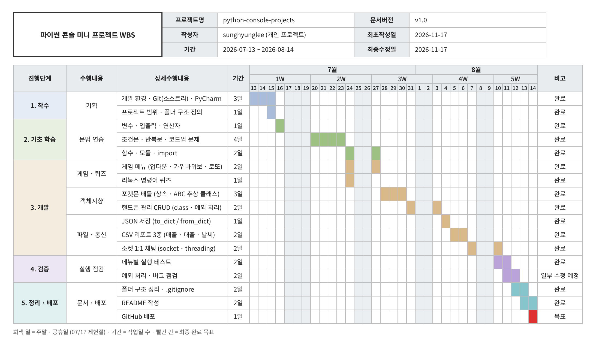

# python-console-projects

파이썬 기초를 배우면서 직접 만든 콘솔(터미널) 미니 프로젝트 모음입니다.
대부분 PyCharm에서 직접 작성했고, 변수·조건문·반복문부터 함수, 모듈, 클래스(상속·추상 클래스), 예외 처리, 파일(JSON·CSV), 소켓 통신까지 단계별로 연습했습니다.

## 프로젝트 목록

| # | 프로젝트 | 주요 개념 | 실행 |
|---|---|---|---|
| 01 | [게임 메뉴](01_game_menu) — 업다운 · 가위바위보 · 로또 | 함수, 모듈 분리(`import`), `random`, `while` 메뉴 루프 | `python main.py` |
| 02 | [리눅스 명령어 퀴즈](02_linux_quiz) | 리스트·딕셔너리, `random.sample`, 대소문자 무시 채점, 등급, 재시도 | `python linux_quiz.py` |
| 03 | [핸드폰 관리 CRUD](03_phone_manager) | 클래스, model / controller 폴더 분리, `to_dict` / `from_dict`, JSON 저장 | `python main.py` |
| 04 | [포켓몬 배틀](04_pokemon_battle) | 상속, `ABC` 추상 클래스, 메서드 오버라이드, `match`, 턴제 전투 | `python main.py` |
| 05 | [CSV 리포트](05_csv_report) — 매출 · 도서 대출 · 날씨 | `csv.DictReader`, 딕셔너리로 그룹 집계, `max(key=lambda)`, 리포트 txt 저장 | `python main01.py` 등 |
| 06 | [소켓 1:1 채팅](06_socket_chat) | `socket` 서버 / 클라이언트, `threading`으로 수신 | 서버 → 클라이언트 순서로 실행 |

## 실행 환경

- Python 3.10 이상 (`match` 문 사용)
- 외부 라이브러리 없음 (표준 라이브러리만 사용)
- 각 폴더 안으로 이동한 뒤 실행합니다. 예) `cd 01_game_menu` → `python main.py`

## 배운 순서

변수 · 입출력 → 조건문 · 반복문 → 함수 → 모듈 · 패키지 → 클래스 → 상속 · 추상 클래스 → 예외 처리 → 파일(JSON · CSV) → 쓰레드 · 소켓

## WBS 일정

프로젝트 범위를 진행단계 → 수행내용 → 상세수행내용으로 나누고, 상세수행내용마다 기간을 정해 일정으로 관리했습니다.

